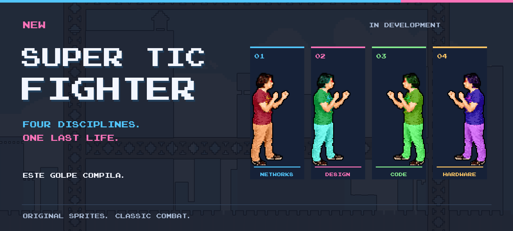
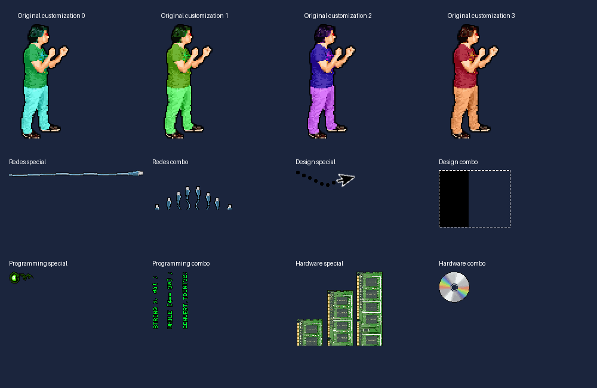

<p align="center">
  
</p>

<h1 align="center">New Super TIC Fighter</h1>

<p align="center">
  <strong>Cuatro disciplinas. Una última vida.</strong><br>
  Settle it with a UTP cable, a mouse pointer, or a spinning disc.
</p>

<p align="center">
  <a href="#choose-your-discipline">The fighters</a> ·
  <a href="#the-next-round">The game</a> ·
  <a href="#development">Development</a> ·
  <a href="#controls">Controls</a> ·
  <a href="docs/implementation-plan.md">The plan</a>
</p>

---

A desktop browser remake of **Super TIC Fighter**, the school-computing platform fighter where your discipline is your moveset and your friends are the target. Keep the digitized human sprites, absurd computer-themed attacks, and original soundtrack; bring the fight to the browser with couch, online, and mixed local/remote play.

**Build damage. Launch friends. Stay on the platforms.** Damage increases knockback, up to 200%. Falling below the arena costs a life. Three lives means three attempts. The last fighter—or team—standing wins.

> **Under construction.** This checkout contains the Classic combat simulation, shared game definitions, and imported art/audio. The browser interface, renderer integration, room service, and end-to-end suite are still pending. There is no playable release linked here yet. The [accepted implementation plan](docs/implementation-plan.md) defines the release scope and acceptance gates.

## Choose your discipline

One shared set of fists. Four very different ways to escalate.

| Discipline | Special | Combo | Attitude |
| :--- | :--- | :--- | :--- |
| **Redes** · Networks | Extending UTP cable | Cables erupting from the platform | A direct connection to the chin. |
| **Diseño** · Design | Fast mouse-pointer projectile | Delayed selection-box attack | Select. Copy. Smash. |
| **Programación** · Programming | Green code projectile | Rising column of code | This punch compiles. |
| **Hardware** | Growing RAM obstacle | Spinning disc projectile | A forceful upgrade. |

Every discipline shares punch, uppercut, sweep, and directional guard. Hair, shirt, and trousers are independent: **64 looks per discipline** from the original layered artwork.

<details>
<summary><strong>Open the original sprite drawer</strong></summary>



Historical asset reference, not a screenshot of the browser remake. The banner above is also a composition of the original assets; its [source](docs/readme/generate-banner.py) is included.

</details>

## The next round

The accepted first release is built around:

- **Two to four fighters.** Couch, online, or a mix of local and remote players; free-for-all and 2v2.
- **Three arenas.** The original skyline and steel girders of **Clásico**, an after-school brawl in **Laboratorio TIC**, and oversized circuitry in **Dentro de la PC**.
- **Your setup.** Keyboards, gamepads, remapping, names, appearance, lives, timers, and friendly fire.
- **Sparring partners.** Optional Easy/Normal bots in local and online matches, plus practice with unlimited respawns.
- **One more match.** Setup, readiness, pause, results, and rematch; Spanish by default with an English switch.
- **The soundtrack returns.** Eight original recordings, sixteen remake tracks, the menu intro, and eighteen gameplay sound effects, with music loaded on demand.

Online play is designed around private room links/codes, direct WebRTC connections, and a WebSocket relay fallback. The host browser runs the match. Hosting targets **Cloudflare Free**; local and practice modes are designed to work independently of the room service.

## Controls

These are the configured keyboard defaults in [the shared settings](src/shared/defaults.ts); playable input integration is pending.

| Action | Player 1 | Player 2 | Player 3 | Player 4 · numpad |
| :--- | :---: | :---: | :---: | :---: |
| Move left / right | A / D | ← / → | G / J | 4 / 6 |
| Jump | W | ↑ | Y | 8 |
| Crouch | S | ↓ | H | 5 |
| Punch | Z | I | B | 1 |
| Special | X | O | N | 2 |
| Guard | C | P | M | 3 |
| Combo | V | L | K | 0 |

**Crouch + punch** triggers an uppercut. **Crouch + special** triggers a sweep. Combos also support the original direction → crouch → standing special sequence, with a 500 ms window. Guard blocks ordinary frontal punches; specials, combos, uppercuts, and sweeps bypass it.

The planned standard gamepad layout uses stick/D-pad for movement, bottom/left/right/top face buttons for jump/punch/special/combo, right bumper for guard, and Start/Options for pause. Escape pauses on keyboard. Physical controller compatibility still requires hands-on verification.

## Development

Use **Node.js 24** and **pnpm 12.4.2**, the package-manager version pinned in [package.json](package.json).

```sh
pnpm install --frozen-lockfile
pnpm typecheck
```

The remaining scripts describe the application workflow as integration lands:

| Command | Purpose | Current checkout |
| :--- | :--- | :--- |
| `pnpm dev` | Vite frontend | Pending `src/main.tsx` and UI/rendering integration |
| `pnpm dev:server` | Local room service on port 8787 | Pending Worker implementation and Wrangler configuration |
| `pnpm build` | Type check + production bundle | Pending frontend entry point |
| `pnpm preview` | Serve the production bundle locally | Requires a successful build |
| `pnpm e2e` | Whole-application Playwright checks | Pending application/service flows and test configuration |

Vite is configured to forward `/api` requests and WebSockets to the local room service. Runtime art and audio are already committed; the original source archives are not required for ordinary development.

### Under the hood

| Layer | Technology | Owns |
| :--- | :--- | :--- |
| Interface | React + Tailwind CSS | Menus, setup, HUD, settings, results |
| Game view | Phaser | Sprites, animation, arena, camera, effects |
| Simulation | Framework-independent TypeScript in a Web Worker | Fixed 60 Hz rules, movement, combat, bots, lives, outcomes |
| Transport | WebRTC + WebSockets | Direct gameplay, room coordination, relay fallback |
| Hosting | Cloudflare Workers + SQLite Durable Objects + Static Assets | Rooms, signaling, relay, application/media delivery |

**The simulation owns the rules.** Phaser renders snapshots; React presents UI state. Local humans, remote humans, and bots feed the same action model. See the [simulation guide](src/simulation/README.md) for its API, timing, and integration boundaries.

```text
src/
  shared/           Types, content definitions, default controls and settings
  simulation/       Combat, geometry, bots, and the worker entry point
public/assets/      Imported fighters, effects, platforms, portraits, and audio
scripts/            Asset import tooling
docs/               Accepted plan, historical research, and asset provenance
```

### Shipping a round

Changes use conventional commits and focused PRs. Validation follows the game all the way through: type/build checks, complete browser flows, full-service multiplayer sessions, and playtesting. **No unit tests.**

Use Arc for hands-on playtesting; isolated Playwright runs may cover Chromium, Firefox, and WebKit. Record what was actually exercised: simulated controller inputs do not establish physical controller support, and automated WebKit does not establish Safari compatibility. Release acceptance includes a real session with the owner and friends on separate networks.

## From the archive to the browser

The remake draws on the **2017 original**, the **2020 Unity remake**, and the recovered Drive assets. Original source folders remain read-only. Imported assets retain source paths, hashes, and deliberate corrections in the [provenance manifest](docs/asset-provenance.json).

| Read next | What it explains |
| :--- | :--- |
| [Implementation plan](docs/implementation-plan.md) | Accepted scope, architecture, milestones, release gates |
| [Game understanding](docs/game-understanding.md) | The game's identity and what the recovered sources establish |
| [Original gameplay reference](docs/original-gameplay-reference.md) | Combat values, timing, collision rules, source anchors |
| [Remake history](docs/remake-history.md) | How the Unity version evolved |
| [Soundtrack reference](docs/soundtrack-reference.md) | Recording inventory and verified audio relationships |
| [Asset provenance](docs/asset-provenance.json) | Where imported media came from and what was corrected |

Historical references document evidence; the accepted implementation plan governs this remake. Artwork and recordings retain their original provenance; inclusion here does not imply new authorship or a blanket reuse license.

---

<p align="center"><strong>Este golpe compila.</strong></p>
