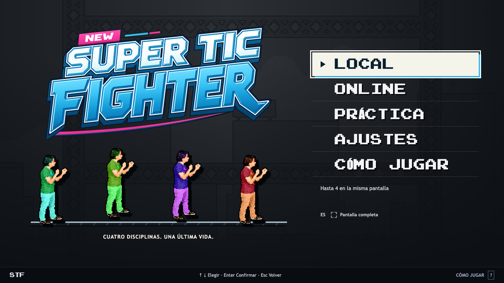

<p align="center">
  
</p>

<h1 align="center">New Super TIC Fighter</h1>

<p align="center">
  <strong>Cuatro disciplinas. Una última vida.</strong><br>
  Settle it with a UTP cable, a mouse pointer, or a spinning disc.
</p>

<p align="center">
  <a href="https://new-super-tic-fighter.new-super-tic-fighter.workers.dev"><strong>PLAY NOW</strong></a> ·
  <a href="#choose-your-discipline">The fighters</a> ·
  <a href="#the-next-round">The game</a> ·
  <a href="#controls">Controls</a> ·
  <a href="#development">Development</a> ·
  <a href="#release-status">Release status</a>
</p>

---

A desktop browser remake of **Super TIC Fighter**, the school-computing platform fighter where your discipline is your moveset and your friends are the target. Original human sprites, absurd computer-themed attacks, and the returning soundtrack meet couch, online, and mixed local/remote play.

**Build damage. Launch friends. Stay on the platforms.** Damage increases knockback, up to 200%. Falling below the arena costs a life. Three lives means three attempts. The last fighter—or team—standing wins.

> **Playable release candidate.** Local, practice, and online matches are implemented. A real session with friends on separate networks remains the release acceptance gate. See [what has been verified](#release-status).

[Playing guide](docs/playing.md) · [GitHub CI](https://github.com/IgnacioPardo/New-Super-TIC-Fighter/actions/workflows/verify.yml) · [Deployment status](https://github.com/IgnacioPardo/New-Super-TIC-Fighter/deployments) · [Accepted plan](docs/implementation-plan.md)

## Jump in

1. **[Open the game](https://new-super-tic-fighter.new-super-tic-fighter.workers.dev)** on a desktop browser. Press a key, click, or use the controller's confirm/Start button to enter the title menu.
2. **Choose your match.** Local shares one computer; Online creates or joins a room by invitation link/code; Practice offers a bot or stationary opponent. Online also supports multiple players sharing one computer.
3. **Pick a discipline, look, and device.** Set the arena and rules, ready up, and fight. Online starts when everyone is ready and the host launches the round.

No accounts or public matchmaking. If a controller-only session starts silently, click or press a key to let the browser enable sound. Keep the host's tab visible during online play; hiding it pauses the round. The host resumes with a three-second countdown.

<details>
<summary><strong>See the current title screen</strong></summary>



Captured from the local production build during [branding verification](docs/verification.md#refined-logo-integration-local-verification--11-october-2026). The [deployment record](https://github.com/IgnacioPardo/New-Super-TIC-Fighter/deployments) identifies what is live.

</details>

## Choose your discipline

One shared set of fists. Four very different ways to escalate.

| Discipline | Special | Combo | Attitude |
| :--- | :--- | :--- | :--- |
| **Redes** · Networks | Extending UTP cable | Cables erupting from the platform | A direct connection to the chin. |
| **Diseño** · Design | Fast mouse-pointer projectile | Delayed selection-box attack | Select. Copy. Smash. |
| **Programación** · Programming | Green code projectile | Rising column of code | This punch compiles. |
| **Hardware** | Growing RAM obstacle | Spinning disc projectile | A forceful upgrade. |

Every discipline shares punch, uppercut, sweep, and directional guard. Hair, shirt, and trousers are independent: **64 looks per discipline** from the original layered artwork.

<details>
<summary><strong>Open the original sprite drawer</strong></summary>


Historical asset reference, not a screenshot of the browser remake. The banner above is also a composition of the original assets; its [source](docs/readme/generate-banner.py) is included.

</details>

## The next round

The current build brings the full match loop to the browser:

- **Two to four fighters.** Couch, online, or a mix of local and remote players; free-for-all and 2v2.
- **Three arenas.** The original skyline and steel girders of **Clásico**, an after-school brawl in **Laboratorio TIC**, and oversized circuitry in **Dentro de la PC**.
- **Your setup.** Keyboards, gamepads, remapping, names, appearance, lives, timers, and friendly fire.
- **Sparring partners.** Optional Easy/Normal bots in local and online matches, plus practice with unlimited respawns.
- **One more match.** Setup, readiness, pause, results, and rematch; Spanish by default with an English switch.
- **Arcade presentation.** The Overdrive identity, a separate opening screen, animated fighter portraits, contact shadows, hit effects, and reduced-motion settings.
- **The soundtrack returns.** Eight Original tracks and seventeen Remake tracks, including Facundo Pereyra's 8-bit arrangement of Rata Blanca's “La leyenda del Hada y el Mago.” Danger Zone loops on the title screen and menus; match playlists shuffle without immediate repeats and load music on demand.
- **Every hit has a voice.** Eighteen original gameplay effects plus sixteen CC0 samples for menus and combat feedback, with separate music/effects volume controls.

Online play uses direct WebRTC connections with a WebSocket relay fallback. The host browser runs the match; guests predict their own movement while hits and results come from the host. Disconnected guests have a 15-second recovery window; losing the host ends the round without a winner. See the [playing guide](docs/playing.md#rounds-and-reconnecting) for reconnects and rematches.

Hosting runs on **Cloudflare Free**. Local and practice play do not need the room service.

## Controls

These are the keyboard defaults; bindings can be changed in Settings. The [playing guide](docs/playing.md) also explains controllers and reconnects.

| Action | Player 1 | Player 2 | Player 3 | Player 4 · numpad |
| :--- | :---: | :---: | :---: | :---: |
| Move left / right | A / D | ← / → | G / J | 4 / 6 |
| Jump | W | ↑ | Y | 8 |
| Crouch | S | ↓ | H | 5 |
| Punch | Z | I | B | 1 |
| Special | X | O | N | 2 |
| Guard | C | P | M | 3 |
| Combo | V | L | K | 0 |

**Crouch + punch** triggers an uppercut. **Crouch + special** triggers a sweep. Combos also support the original direction → crouch → standing special sequence, with a 500 ms window. Guard blocks ordinary frontal punches; specials, combos, uppercuts, and sweeps bypass it.

Standard gamepads use stick/D-pad for movement, A/Cross for jump, X/Square for punch, B/Circle for special, Y/Triangle for combo, right bumper for guard, and Start/Options for pause. Escape pauses on keyboard.

Menus always use A/Cross to confirm and B/Circle to go back, independently of combat remapping. An available controller is assigned to the first human fighter on setup entry; each fighter's device selector stays visible. Settings shows detected controllers, recent input, button mappings, and stick dead zone. Unplugging a controller pauses play and requires explicit reclaim.

**Physically checked:** the owner confirmed Bluetooth DualSense menu navigation and gameplay on macOS with Arc. Xbox, other controller/browser combinations, and native Safari still need verification. The [controller record](docs/controller-verification.md) separates that hands-on check from injected input exercises and includes the Arc detection workaround.

## Development

Use **Node.js 24** and **pnpm 12.4.2**, the package-manager version pinned in [package.json](package.json).

```sh
pnpm install --frozen-lockfile
pnpm build
```

Start the room service in one terminal, then Vite in another:

```sh
# Terminal 1: room service and built assets
pnpm dev:server
```

```sh
# Terminal 2: frontend with live updates
pnpm dev
```

Open **[localhost:5173](http://127.0.0.1:5173)**. Vite forwards `/api` requests and WebSockets to the Worker on port 8787. Build first because Wrangler serves the generated `dist` assets. For frontend-only local/practice work, the room service is optional. Runtime art and audio are committed; historical source archives and deployment credentials are not needed for local development.

| Command | Purpose |
| :--- | :--- |
| `pnpm dev` | Vite frontend on port 5173 |
| `pnpm dev:server` | Local room service on port 8787 |
| `pnpm typecheck` | Client TypeScript check |
| `pnpm exec tsc -p tsconfig.server.json --noEmit` | Worker and room-service TypeScript check |
| `pnpm build` | Client type check and production bundle |
| `pnpm preview --port 4173` | Stable production preview after building |
| `pnpm e2e` | Complete browser, device, settings, and multiplayer lifecycle flows |
| `pnpm e2e:transport` | Room service and real browser transport flows |
| `pnpm e2e:audio` | Actual Worker HTTP streaming and exact music byte ranges |
| `pnpm e2e:audio-playback` | Real browser menu loops, playlist playback, seeking, and shuffle |

### Verify a build

Install the isolated browsers once with `pnpm exec playwright install chromium firefox webkit`. Keep `pnpm dev:server` running and start `pnpm preview --port 4173` in another terminal. Against that production build:

```sh
pnpm exec tsc -p tsconfig.server.json --noEmit
python3 scripts/make-audio-headers.py --check
STF_APP_URL=http://127.0.0.1:4173 pnpm e2e
pnpm e2e:transport
pnpm e2e:audio
STF_APP_URL=http://127.0.0.1:8787 pnpm e2e:audio-playback
```

Set `STF_APP_URL` explicitly for the combined browser suite: individual scripts have different default ports. Audio playback uses the Worker on **8787** so checks exercise its MP3 streaming behavior. `STF_SERVER_URL` selects a different room endpoint, `STF_AUDIO_ORIGIN` selects the HTTP media-check origin, and `STF_BROWSERS` selects engines for scripts that support it. Do not rebuild during browser exercises.

### Deployment and assets

Cloudflare builds and deploys `main` automatically; GitHub runs the separate verification workflow. Manual deployment uses `pnpm run deploy` after verification and Cloudflare authorization. Keep the `run`: bare `pnpm deploy` is a different pnpm command. See [hosting and maintenance](docs/hosting.md) for status, free-service limits, and rollback.

The selected Overdrive logo appears on the intro/title screens, responsive header, browser icons, and link preview. Republish the design masters and provenance with `python3 scripts/import-branding.py`; regenerate this README's banner with `python3 docs/readme/generate-banner.py` (Python + Pillow). After music changes, run `python3 scripts/make-audio-headers.py` before building; [audio streaming](docs/audio-streaming.md) documents the media path.

### Under the hood

| Layer | Technology | Owns |
| :--- | :--- | :--- |
| Interface | React + Tailwind CSS | Menus, setup, HUD, settings, results |
| Game view | Phaser | Sprites, animation, arena, camera, effects |
| Simulation | Framework-independent TypeScript in a Web Worker | Fixed 60 Hz rules, movement, combat, bots, lives, outcomes |
| Transport | WebRTC + WebSockets | Direct gameplay, room coordination, relay fallback |
| Hosting | Cloudflare Workers + SQLite Durable Objects + Static Assets | Rooms, signaling, relay, application/media delivery |

**The simulation owns the rules.** Phaser renders snapshots; React presents UI state. Local humans, remote humans, and bots feed the same action model. See the [simulation guide](src/simulation/README.md) for its API, timing, and integration boundaries.

```text
src/
  shared/           Types, content definitions, default controls and settings
  simulation/       Combat, geometry, bots, and the worker entry point
  game/             Phaser rendering and camera
  ui/               Setup, HUD, settings, guide, and controls
  network/          Room signaling and WebRTC/relay transports
  online/           Host authority and guest prediction integration
server/             Cloudflare Worker and room Durable Object
public/assets/      Imported fighters, effects, platforms, portraits, and audio
scripts/            Asset tooling and complete application/service exercises
docs/               Accepted plan, historical research, and asset provenance
```

### Shipping a round

Changes use conventional commits and focused PRs. Validation follows the game all the way through: type/build checks, complete browser flows, full-service multiplayer sessions, and playtesting. **No unit tests.**

Use Arc for hands-on playtesting; isolated Playwright runs may cover Chromium, Firefox, and WebKit. Record what was actually exercised: simulated controller inputs do not establish physical controller support, and automated WebKit does not establish Safari compatibility. Release acceptance includes a real session with the owner and friends on separate networks.

## Release status

The [verification record](docs/verification.md) documents complete matches, all three arenas, browser/worker rendering, direct and relayed multiplayer, reconnection, results/rematches, and production media checks. Later branding and soundtrack entries identify their local verification separately from deployment.

- **Automated:** Chromium, Firefox, and WebKit application flows; real browser audio and transports; injected controller coverage. Individual scripts and their limits are recorded in the verification docs.
- **Hands-on:** Arc keyboard playtesting and the owner's Bluetooth DualSense menu/gameplay confirmation on macOS, recorded in [controller verification](docs/controller-verification.md).
- **Still to validate:** the owner/friends session across separate networks, Xbox and other physical device combinations, native Safari, long host background/sleep/wake behavior, and production quota exhaustion.

## From the archive to the browser

The remake draws on the **2017 original**, the **2020 Unity remake**, and the recovered Drive assets. Original source folders remain read-only. Imported assets retain source paths, hashes, and deliberate corrections in the [provenance manifest](docs/asset-provenance.json).

| Read next | What it explains |
| :--- | :--- |
| [Hosting and maintenance](docs/hosting.md) | Deployment, GitHub status, free limits, rollback |
| [Verification](docs/verification.md) | Measured results and remaining acceptance coverage |
| [Controller verification](docs/controller-verification.md) | Physical DualSense check, injected coverage, Arc troubleshooting |
| [Audio polish sources](docs/audio-polish-sources.md) | Added samples, CC0 licenses, mix behavior, verification |
| [Soundtrack additions](docs/soundtrack-additions.json) | Credits and hashes for the added Rata Blanca arrangement |
| [Implementation plan](docs/implementation-plan.md) | Accepted scope, architecture, milestones, release gates |
| [Game understanding](docs/game-understanding.md) | The game's identity and what the recovered sources establish |
| [Original gameplay reference](docs/original-gameplay-reference.md) | Combat values, timing, collision rules, source anchors |
| [Remake history](docs/remake-history.md) | How the Unity version evolved |
| [Soundtrack reference](docs/soundtrack-reference.md) | Recording inventory and verified audio relationships |
| [Asset provenance](docs/asset-provenance.json) | Where imported media came from and what was corrected |

Historical references document evidence; the accepted implementation plan governs this remake. Artwork and recordings retain their original provenance; inclusion here does not imply new authorship or a blanket reuse license.

---

<p align="center"><strong>Este golpe compila.</strong></p>
