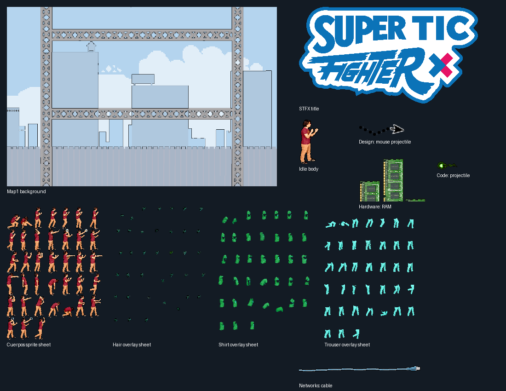

# Understanding Super TIC Fighter

This reference brings together the complete 2017 archive, the 2020 Unity repository and its history, and the newly recovered Drive export. It records the game that exists in the sources, the direction of the remake, and the gaps the web version must address. It is not yet the implementation plan.

For the accepted web-game scope, React/Tailwind architecture, new arenas, bots, and release criteria, see the [revised implementation plan](implementation-plan.md). This document remains the historical game reference; statements below about formerly open product choices are superseded by that plan.

## The game’s identity

Super TIC Fighter is a simultaneous 2–4-player platform fighter. The aim is to launch friends off the platforms until they run out of respawns. Damage is a percentage that increases knockback; it is not a conventional health bar. The game’s personality comes from recognizable human fighter sprites, independent clothing and hair colors, a school/computing theme, and attacks built from cables, mouse pointers, RAM, discs, and programming text.

The four choices are TIC disciplines, not four named characters. Every player shares the same body and basic martial-arts moves, then gets a discipline-specific special and combo. Hair, shirt, and trousers each have four choices, giving 64 combinations independently of discipline. Names come from player setup. The saved example’s friend names are not a fixed roster.

## How a match plays

The original starts players above the arena and plays the Fight sound immediately. There is no ready countdown. Players accelerate left/right, steer in the air, jump from the ground, crouch, punch, uppercut, sweep, and hold a directional guard. Most attacks require being grounded and commit the player to an animation/recovery period. There is one jump, with a cooldown; no double jump, dash, air dodge, grab, recovery special, pickups, or teams were found.

An ordinary punch pushes opponents outward. Crouch plus punch is an uppercut that launches upward and makes the attacker rise. Crouch plus special is a sliding sweep with stronger horizontal launch. Holding guard protects only against an ordinary punch arriving from the front; it does not protect against the other attacks in the original implementation. Guard has no stamina meter or parry timing.

Each discipline has a characteristic range and attack shape:

| Discipline | Special | Combo | Character of the moveset |
|---|---|---|---|
| Redes | An extending and retracting UTP cable | Cables rising from the platform | Reach and vertical launch |
| Diseño | A fast mouse pointer with a dotted trail | A selection rectangle whose damaging phase is delayed | Fast projectile and a timed close-range trap |
| Programación | A slower green code projectile | A column of code moving upward | Horizontal pressure and vertical coverage |
| Hardware | RAM sticks growing upward from a surface | A fast spinning optical disc | A growing obstacle and long-range projectile |

The original combo is a directional sequence: left or right, then down, then special after standing again. Its input history never expires, so a combo can be triggered long after the first input. The same history also lets combos bypass part of normal recovery. These are verified historical behaviors, not automatically desirable new rules.

Attacks add damage and apply immediate launch velocity based on the victim’s percentage before that hit. Percentage caps at 200. A hit-reaction period temporarily prevents further hits. Mouse and programming-ball effects disappear on impact; the other class effects can persist. Projectiles do not collide with the stage or each other. Effects are tied to their owner’s action rather than independent entities.

Only falling below the bottom threshold eliminates a life in the original; there are no left, right, or top blast zones. Respawn places the fighter at a random horizontal position above the stage and resets damage. The last active fighter wins. On timeout, players tied for the most remaining respawns share victory; there is no damage tiebreaker or sudden death.

The original’s displayed life count actually counts remaining respawns: a player at x0 is still alive. Several resets and tie cases are incomplete. Its timer also runs at the wrong cadence: a configured 30-second match lasts roughly 45 real seconds at 60 updates per second. The web rules should explicitly separate the remembered combat feel from these accidental implementation details.

The complete values, hit windows, formulas, collision order, controls, and known defects are recorded in [the original gameplay reference](original-gameplay-reference.md).

## Arenas and presentation

The original uses a fixed 1366×768 view with six steel-girder platforms at three heights. Players can rise through platforms and land on top. There is no floor underneath. The playable code clears the background to blue; the finished industrial skyline and truss artwork was present in the design folder but never drawn.

The remake integrates that backdrop, with only tiny pixel edits, and places two broad platforms in a test layout. This is an alternate arrangement of the same setting, not evidence of a second fully designed environment. The remake’s experimental camera centers and zooms to encompass the fighters. Its implementation exists and was briefly active in history, then disabled in the final scene.

The fighters are digitized/pixel-treated human figures with translucent edge pixels, not interchangeable cartoon placeholders. Their animation is built from a body plus hair, shirt, and trouser layers. The Drive export’s normalized 60×96 frames are important: all 380 occupied tiles in the Unity sheets exactly match those frames. Some edited crouch/block bodies no longer align with their clothing layers. The normalized set is the strongest reference for preserving the look without visual jitter.

There are 38 common animation frames per appearance layer, plus one extra unused guard body. The complete original art also includes all eight class-effect families, sixteen portrait HUD panels, and the three girder-platform sizes. These fuller collections are not all present in the Unity repository, but the Drive and original archive recover them.

The design archive additionally contains eight layered PSD masters, alternate poses/effect exports, and 104 RAM-growth frames inside ZIPs. Those are art revisions and animation source, not additional gameplay systems. Black pixels must not be globally removed: the final selection-box frames intentionally contain an opaque black fill. One separate solid-black crouch placeholder should be excluded.

The remake contributes the blue/white Super TIC Fighter X logo with its pink X, the outlined LOCAL/ONLINE graphics, and Arcade Normal menu typography. Its title identity is distinct from the original archive’s ORT CORP studio logo.

## Interface and the player journey

The original archive contains the battle HUD, not a complete standalone launcher. It reads player count, time, respawns, colors, disciplines, and names from a text file. Portraits sit in four screen corners alongside name, percentage, and remaining respawns; the timer is centered. Eliminated fighters and their HUD panels disappear. Escape closes the game. There is no in-game pause, settings, rematch, or control-remapping screen.

On victory it writes winner/loser names and launches a separate Winner.exe. That program and the original launcher are absent from every supplied directory. An Access database preserves one saved profile and fields for statistics, preferred map, and additional cosmetic ideas. The game does not read that database, so those fields are evidence of surrounding plans or missing functionality, not implemented battle features.

The Unity menu flow is explicit: blinking Press any key to play → LOCAL/ONLINE menu → online name, Host, and Join fields. The field called PIN actually expects a raw IP address. Local’s button has no handler. Host or Join enters the game immediately without a readiness roster or successful-connection confirmation. The game HUD is text for names, stocks, and percentages; no finished results/rematch flow exists.

The web version consequently needs a coherent journey covering entry, controls, player/discipline/customization selection, local setup or room invitation, readiness, match, results, rematch, and disconnection recovery. Those flows should be designed deliberately; there is no hidden complete old UI to copy pixel for pixel.

## Soundtrack and sound design

The original uses eight music recordings at 60% volume, choosing a different random track when the current one stops. It has eighteen WAV effects covering the opening Fight announcement, punches, guard contact, hit reactions, sweeps, and the discipline attacks. Sound triggers are specific: for example, the cable’s hit uses Latigo, the mouse impact uses golpeMouse, and Hardware RAM has separate preparation and activation cues. Jumping, landing, respawning, and victory have no direct sound cues in the available battle source. The wider audio folder contains 148 MK1-named sample files; they are not all used in the game.

The Drive’s eight WMA files contain the same encoded audio as the original build. The remake initially imported the original eight MP3s byte for byte, then replaced them with sixteen numbered recordings. It also contains a separate approximately two-minute intro with GarageBand metadata. At the final snapshot, the menu intro and game music manager are disabled, and all eight old serialized playlist references are broken.

The one-page historical OST list names rock and metal songs including Danger Zone, Welcome to the Jungle, Crazy Train, Chop Suey, Thunderstruck, Holy Wars, Du Hast, Master of Puppets, Robot Rock, and others, with several chiptune references. This establishes a musical direction. It does not provide a reliable mapping between fifteen listed titles and sixteen numbered final files. Local audio comparison confirms reused recorded passages for two final tracks and suggests several more relationships, but no exact title mapping is invented.

The web audio choice remains open. This audit establishes what exists and how it was used; it does not silently replace the soundtrack, claim authorship, or promise reuse rights. The detailed recording inventory, durations, history, and matching evidence are in [the soundtrack reference](soundtrack-reference.md).

## What the remake actually adds

The remake’s strongest direction is moving from one keyboard to online play, adding a recognizable title/menu flow, displaying the completed environment art, packaging modular sprites consistently, and experimenting with automatic camera framing and a shared shuffled playlist.

Its combat is less complete than the original’s. Uppercut, sweep, and combo input branches are placeholders; ordinary punch animation is not connected to spawned hitboxes; class specials lack complete damage/network wiring. Customization, guard behavior, several animations, and end-of-match handling are unfinished. The final commit also contains a HUD syntax regression. Earlier history supports the owner’s account of a working networking prototype, but that is different from a fully integrated game.

The complete 73-commit history was inspected for development progression, removed first-party content, soundtrack changes, camera activation, and final regressions. The web port should carry forward the remake’s useful ideas while using the original for concrete combat rules. [Remake reference](remake-reference.md) · [History reference](remake-history.md)

## Coverage and limits of this understanding

| Source | Loose or tracked files | Coverage |
|---|---:|---|
| Original archive | 1,875 | Every directory, all first-party source/config, textures, design variants, PSD layers, archives, database, audio metadata, XNB comparisons, and the unrelated Unity experiment |
| Unity repository | 320 at HEAD | All first-party code, both scenes, every prefab/animation/controller, project settings, assets, dependency integration, and all 73 commits’ history structure with focused feature-change inspection |
| Drive export | 990 | Every directory/file, both complete sprite collections, all eight WMA files, and the rendered one-page OST document |

This is 3,185 loose/tracked files, plus 104 inspected image members inside the original ZIPs. The combined hashed inventory is retained in `source-inventory.json`. Framework internals and generated caches were classified rather than mistaken for new game features. No historical executable or Unity editor build was run; the original XNA Windows build and current Unity snapshot were analyzed through their sources/assets. No original files were modified.

The genuine remaining evidence gaps are the missing original launcher/results applications, the exact filename-to-title mapping for unnamed music, and how the earlier demo felt in live play. The supplied files cannot resolve those by themselves. Existing product decisions for the web version remain intact; the pending combat, language, and audio choices have not been assumed, and implementation has not begun.
